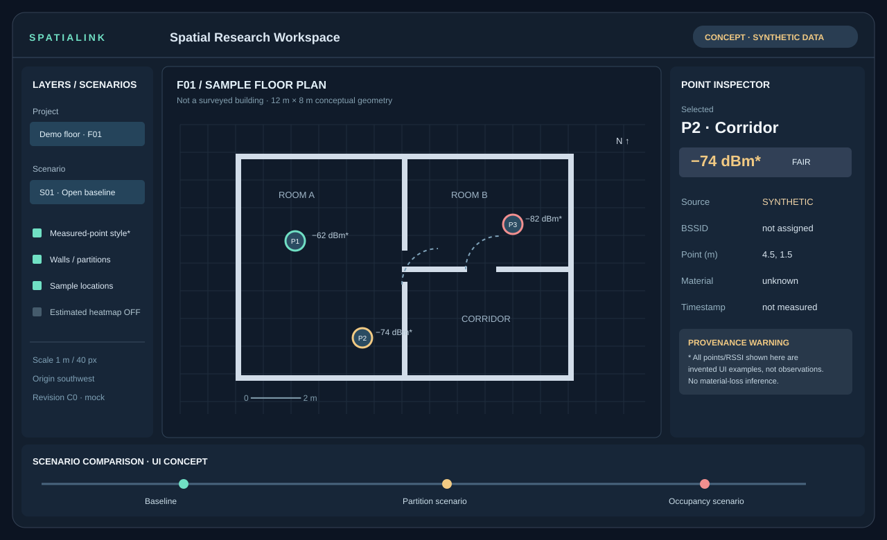

# SPATIALINK
### Where Space Shapes Signal. — 공간이 신호를 바꾼다

**건축 공간 분석 × 무선 신호 측정 × 공간 시각화**

SPATIALINK는 건축 평면, 벽체·자재, 공간 점유 조건과 실내 2.4 GHz Wi-Fi 수신 신호 세기(RSSI)의 관계를 조사하는 연구용 플랫폼입니다. **배재대학교 캠퍼스를 1차 현장 실증 후보지**로 설정합니다. 특정 건물 사용 승인·도면 확보·실측은 아직 완료되지 않았습니다.

## 연구 및 개발 역할

- **박하음 | 건축학과 · 건축 공간 연구 및 UI/UX 방향:** 실증 공간 선정, 평면도·재료 분류, 공간 시나리오, 측정점 배치, 시각화 검토
- **이영준 | 컴퓨터공학과 · 시스템 개발:** ESP32 펌웨어, FastAPI·SQLite, React, 측정 데이터 연동, 자동화 검증

건축 UI 시안과 관련 설계 문서는 **AI가 작성한 검토용 초안**이며 박하음이 직접 작성·승인한 결과물로 표시하지 않습니다. 기존 SiteLink 기여 기록은 [프로젝트 기원](docs/project-origins.md)에 보존했습니다.

## 배재대학교 실증 계획

캠퍼스 내 실제 사용 허가를 받을 수 있는 **강의실·복도·공용 학습공간** 중 1곳을 먼저 선정합니다. 측정 목적은 개방 공간, 벽체/출입문 경계, 이용 인원 변화에 따른 RSSI 차이를 비교하는 것입니다.

1. 시설 담당 부서와 공간 이용 및 도면·촬영·측정 허용 범위 확인
2. 도면 축척, 원점, 층·공간 식별자, 측정점 좌표 기록
3. AP/BSSID·채널·장치 위치를 고정한 반복 측정
4. 원시 관측값과 가상 데이터·추정값을 명확히 구분
5. 실험 변동성·교란요인 분석 후 시각화와 예측 모델 검토

**캠퍼스 네트워크를 임의로 스캔·기록하거나 식별 가능한 이용자 정보를 수집하지 않습니다.** 학교 허가 및 네트워크 관리 정책 확인 전에는 가상 데이터로만 시연합니다.

## 현재 구현 범위

| 구성 | 상태 |
|---|---|
| ESP32 2.4 GHz 스캔 펌웨어 | 시제품 코드 구현, 실물 검증 대기 |
| FastAPI 측정·장치·구역 커버리지 API 및 SQLite | 구현 |
| React 현장 콘솔 | 구현 |
| 가상 Scout → 실제 서버 → DB → API E2E | GitHub Actions에서 통과 |
| 측정 구역별 RSSI 등급 분류 | 구현 |
| 실제 평면도 좌표 연계 및 공간 히트맵 | 미구현 |
| 건축 자재·인원 밀도별 감쇠 모델 | 연구 단계, 미검증 |
| CAD/BIM 직접 연동 | 장기 계획 |

현재 커버리지 비율은 **측정 이력이 있는 구역마다 가장 최근 RSSI**를 집계한 값입니다(사용 가능 기준 -75 dBm 이상). 평면 전체의 면적 커버리지나 자재별 감쇠를 뜻하지 않습니다.

## 시스템 구성

```text
배재대학교 공간 및 실험 시나리오(계획)
                    │
ESP32 Scout 또는 가상 데이터 시뮬레이터
   RSSI · SSID · BSSID · 채널 (2.4 GHz)
                    │ HTTP/JSON
                    ▼
             FastAPI → SQLite
                    │
             React 현장 콘솔
                    │
실제 평면도·좌표·공간 레이어 연동(향후 개발)
```

## 개발용 실행

Unix 계열 셸, `backend/.venv`에 설치된 Python 의존성, `frontend/node_modules`, 사용 가능한 8000·5173 포트가 필요합니다.

```bash
./scripts/start-demo.sh
./scripts/simulate-demo.sh
./scripts/check-demo.sh
./scripts/stop-demo.sh
```

- 콘솔: http://localhost:5173
- API 문서: http://127.0.0.1:8000/docs
- 가상 데이터 전송: `python scripts/e2e-smoke.py` (독립 DB 및 서버를 실행하는 CI 스모크 테스트)
- 시뮬레이터 데이터는 **현장 측정값이 아닙니다**. ESP32 펌웨어 설정·빌드는 [시스템 구조](docs/architecture.md) 참고.

## 문서

| 문서 | 내용 |
|---|---|
| [공간 분석 계획](docs/spatial-analysis.md) | 건축 변수, 배재대 실증 후보 조건, 실험 시나리오 |
| [시스템 구조](docs/architecture.md) | 실제 API, 펌웨어, 실행 및 향후 데이터 계층 |
| [검증 계획](docs/validation-plan.md) | 자동 E2E와 물리 실증 구분, 반복 측정 |
| [UI/UX 설계 방향](docs/design-direction.md) | 평면도 중심 화면·가상 시안·검토 항목 |
| [개발 로드맵](docs/roadmap.md) | 단계별 목표와 완료 근거 |
| [프로젝트 기원](docs/project-origins.md) | LH 대회 이력, 기존 기여와 시뮬레이션 수치 |

## 건축 워크스페이스 개념 시안



**주의:** 그림의 건물 형상·치수·RSSI는 배재대학교 실측 자료가 아닌 가상 예시입니다. 박하음 검토 전의 AI 작성 초안이며 현재 구현된 화면도 아닙니다.

**SPATIALINK — Where Space Shapes Signal.**
