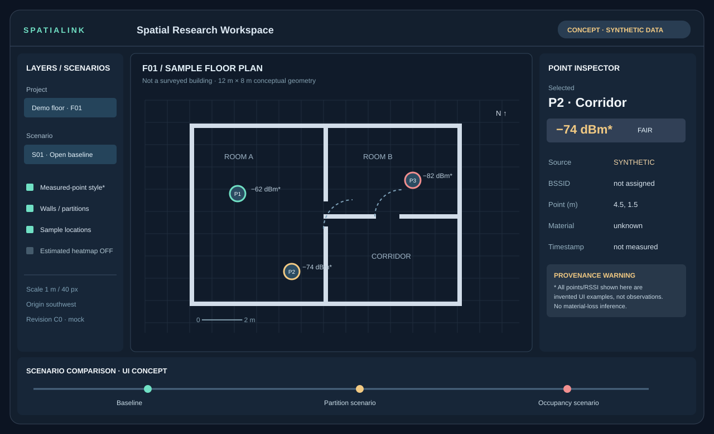

# SPATIALINK 건축 중심 UI/UX 설계 및 인계 문서

> **상태:** AI가 작성한 개념 설계 초안. 박하음이 작성하거나 승인한 문서가 아닙니다.  
> **현장 후보:** 배재대학교 캠퍼스. 실제 건물·층·도면·측정점은 미확정입니다.  
> **예정 역할:** 박하음 — 건축 공간·측정 시나리오·UI/UX 검토 / 이영준 — 데이터 모델·프론트엔드 구현.

## 1. 핵심 방향

**Where Space Shapes Signal.** 건축 평면도가 중심 작업 공간이며, Wi-Fi 측정값은 출처를 가진 개별 점으로 표시합니다. 데이터가 없는데 그라데이션 히트맵을 그려 실측처럼 보이게 하지 않습니다.



[SVG 시안 열기](spatialink-workspace-concept.svg)

**주의:** 시안 속 12m × 8m 평면·방 구조·RSSI 숫자는 전부 **가상 예시**입니다. 배재대학교의 실제 도면이 아니며 현재 구현된 웹 화면도 아닙니다.

## 2. 화면 구성

### 화면 A — 공간 워크스페이스

- **왼쪽:** 프로젝트, 건물·층, 시나리오, 벽체·측정점·추정 레이어 선택
- **중앙:** 축척 있는 평면도, 북쪽 방향, 원점, 벽·문·AP 위치, 관측점
- **오른쪽:** 선택 지점의 좌표·RSSI·BSSID·측정 시각·출처·자료 누락 여부
- **아래:** 기준조건과 변경조건 비교, 불확실성 및 검증 상태

관측점 클릭 시 상세정보를 보여주고, 추정 레이어는 검증 데이터가 준비되기 전 비활성화합니다. **현재 구현된 기능이 아니라 구현 명세입니다.**

### 화면 B — 조건 비교

```text
┌────────────────────┬─────────────────────┐
│ S01 개방 기준조건  │ S02 칸막이 변경조건 │
│ 평면도 + 관측점    │ 동일 평면도 + 관측점│
├────────────────────┴─────────────────────┤
│ 지점별 RSSI 중앙값 / 변화량(dB)          │
│ 표본 수 · 측정 일시 · IQR · 교란요인     │
│ [측정 프로토콜] [CSV 내보내기]           │
└──────────────────────────────────────────┘
```

AP·채널·장치 위치가 바뀐 두 조건을 단일 자재의 감쇠 효과로 비교하지 않습니다.

### 화면 C — 측정 세션

```text
건물 / 층 / 도면 버전 / BSSID / 채널 / AP 높이
측정점 ID / x,y,z(m) / 시나리오 / 벽체 재료 / 인원
출처: [실물 ESP32] [가상 시뮬레이터] [수동 입력]
측정 시작 → 품질 확인 → 원시값 저장 → 통계 요약
```

축척과 좌표가 없으면 **공간 분석 기능만 제한**하고 기존 구역 단위 데이터 수신은 유지합니다.

### 화면 D — 출처 확인 및 내보내기

관측값마다 출처, 도면 버전, 장치·시각 정보를 내보냅니다. 추정값에는 모델 ID·버전·방법·불확실성을 별도로 기록하며 실측값을 덮어쓰지 않습니다.

## 3. 시각화 원칙

| 항목 | 설계 기준 |
|---|---|
| 배경 | 짙은 남색 `#0c1422` |
| 패널 | `#172638` |
| 측정점 강조 | 민트 `#70e0c4`, 문자·아이콘 병기 |
| 가상 데이터 | 호박색 `#f2ca83`, 반드시 **가상 데이터** 표기 |
| 약한 신호 | 산호색 `#f28f8f`, 색상 외 등급 병기 |
| 간격 | 기본 8px 단위 |
| 접근성 | 키보드 조작·대비·스크린리더 설명 |
| 반응형 | 넓은 화면 3열, 중간 화면 접이식 상세정보, 모바일 서랍형 패널 |

**실측 / 가상 / 추정 / 미수집**은 색상만으로 구분하지 않습니다. 측정되지 않은 구역은 '신호 없음'이 아닌 '미측정'으로 표시합니다.

## 4. 배재대학교 파일럿 공간 설정

- 실제 공간 선정 전에는 가상의 **12m × 8m 평면**을 UI 개발용으로만 사용합니다.
- 시안의 P1·P2·P3 및 -62·-74·-82 dBm은 임의로 만든 값입니다.
- 실제 도면을 확보하면 사용 권한, 축척, 북쪽 방향, 원점, 벽체 재료, 버전을 기록합니다.
- 수업·이용자 동선·네트워크 정책을 침해하지 않는 측정점만 제안합니다.

## 5. 건축 검토 체크리스트

| 검토 내용 | 현재 상태 |
|---|---|
| 연구 질문·변수 정리 | 초안 작성 |
| 가상 평면도 UI 구성 | 초안 작성, 미승인 |
| 배재대학교 실제 건물 선정 | 미완료 |
| 도면 사용 및 측정 허가 | 미완료 |
| 축척·방향·재료 현장 확인 | 미완료 |
| 안전한 측정점 배치 | 미완료 |
| 박하음의 디자인 검토·승인 | 미완료 |

박하음은 건축 표기, 공간 시나리오의 현실성, 측정점 배치, 재료 분류, UI의 실측·추정 구분을 검토하면 됩니다. 검토 의견은 날짜가 남는 PR 댓글 또는 수정 문서로 기록합니다.

**작성자 표기 원칙:** AI가 만든 시안을 박하음의 개인 포트폴리오 작업물로 귀속하지 않습니다. 실제 기여는 이후 검토·수정·현장조사 등 확인 가능한 산출물에 근거해 기록합니다.
